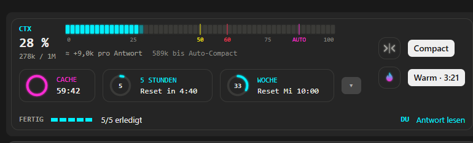

# neon-hud

Cyberpunk-styled bars for **Claude Code**. Each design is its own plugin in this marketplace.

| Plugin | Look |
|---|---|
| **neon-cockpit** | Big context percent, scaled bar, rings for cache and limits, stacked buttons with state icons |

## neon-cockpit

A cockpit bar above the prompt of **Claude Code** (desktop app, also the terminal): how full the context is, when the prompt cache expires, how much of your 5-hour and weekly limits is used, plus a guided **Compact** button and **Keep warm**.



*(Screenshot with the German texts. The default language is English.)*

## What it shows

- **CTX**: context use in percent and tokens, on a bar with a scale. Marks at 50 % (yellow), 60 % (red) and your **AUTO**-compact point. A faint part shows roughly what the next answer will add.
- **Cache ring**: time left until the prompt cache expires (an estimate: one hour after the last request).
- **5 hours / Week rings**: your usage limits with the time until the reset.
- **Focus row**: the current step of Claude's task list and whether it is your turn.
- **▾ button**: details with the context history, growth per answer and limit projections.

## Install

You need Claude Code with plugin (mod) support, a recent desktop app or CLI.

In a Claude Code chat, type:

```
/plugin marketplace add Vitusalix/neon-hud
/plugin install neon-cockpit@neon-hud
```

Or in a terminal:

```bash
claude plugin marketplace add Vitusalix/neon-hud
claude plugin install neon-cockpit@neon-hud --scope user
```

Then type `/reload-plugins` in open chats (new chats load it on their own).

Update later with `/plugin marketplace update neon-hud`, then `/reload-plugins`.

## Settings

Two settings live in `hooks/config.ts` of the installed plugin:

| Setting | Default | Meaning |
|---|---|---|
| `LANG` | `'en'` | Language of the bar: `'en'` or `'de'` |
| `NOTES_FILE` | `'NOTES.md'` | The file the Compact button asks Claude to update |

After a change, run `/reload-plugins`. Note: an update of the plugin replaces this file, so set it again afterwards (or fork the repo and change it there).

## The Compact workflow

The button is made for a "notes first, then compact" habit. The full setup (notes file, `CLAUDE.md` rule, auto-compact threshold) is in **[docs/compact-workflow.md](docs/compact-workflow.md)**.

Short version: press **Compact** → Claude updates the notes file and writes keypoints → the mod puts `/compact Keep only: …` into your input line → press **Enter** → afterwards write "continue".

## Good to know

- Everything runs locally. The mod sends nothing anywhere. The keep-warm ping is a normal (tiny) request to Claude in your own session.
- Cache times and projections are **estimates**; Claude Code does not report the exact cache expiry.
- Buttons use the app's own style; the bar uses the app's window grey.

## Development

```bash
claude plugin validate plugins/neon-cockpit
claude plugin test plugins/neon-cockpit
```

Code: `plugins/neon-cockpit/hooks/`. Texts in `i18n.ts`, drawing in `view.tsx` and `svg-wide.ts`, logic in `actions.ts` and `register.tsx`.

---

## Deutsch (kurz)

neon-cockpit: eine Leiste über der Eingabezeile von Claude Code: Kontext-Füllstand, Cache-Countdown, 5-Stunden- und Wochenlimit, dazu ein geführter **Compact**-Knopf und **Warm halten**.

**Installieren** (im Chat):

```
/plugin marketplace add Vitusalix/neon-hud
/plugin install neon-cockpit@neon-hud
```

Danach `/reload-plugins`. Auf Deutsch umstellen: in `hooks/config.ts` `LANG = 'de'` setzen, dann `/reload-plugins`.

Die Anleitung für den Compact-Ablauf (Notiz-Datei, Regel in `CLAUDE.md`, Auto-Compact-Grenze) steht in [docs/compact-workflow.md](docs/compact-workflow.md) (Englisch).

License: MIT
